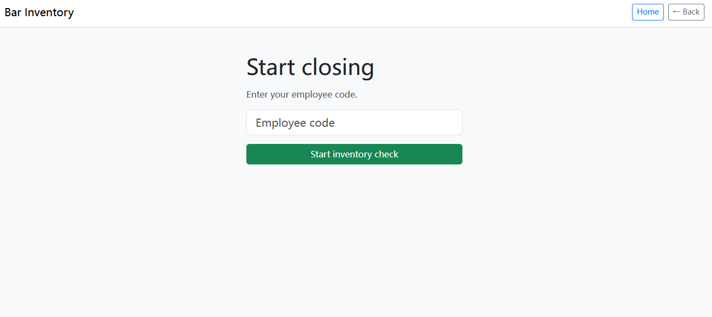
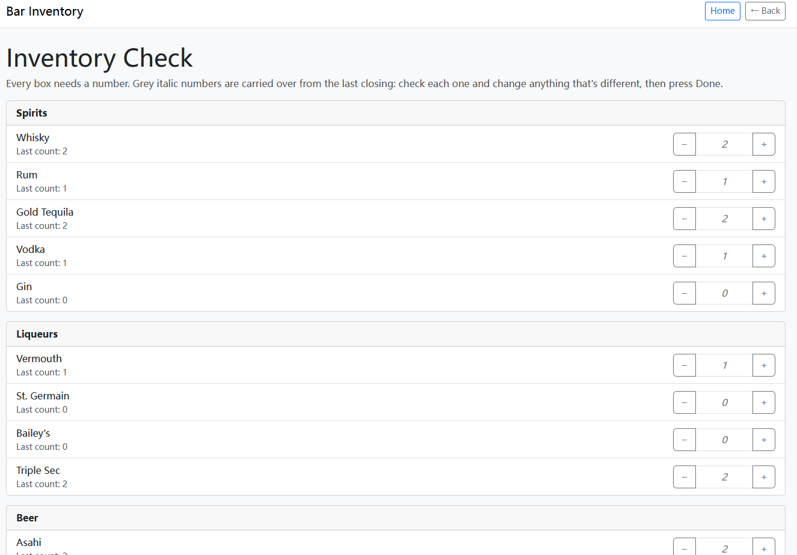
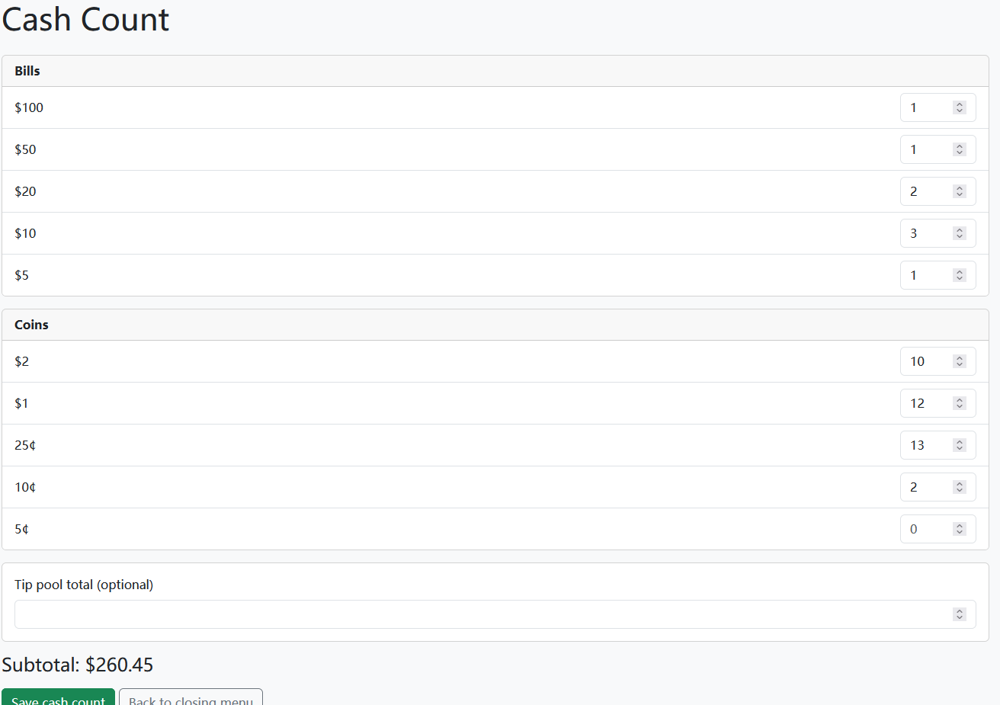
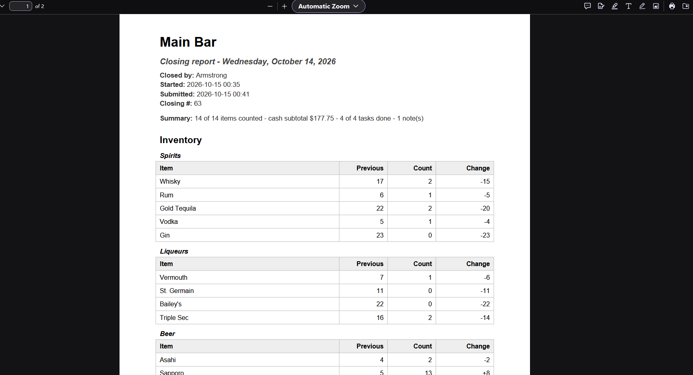
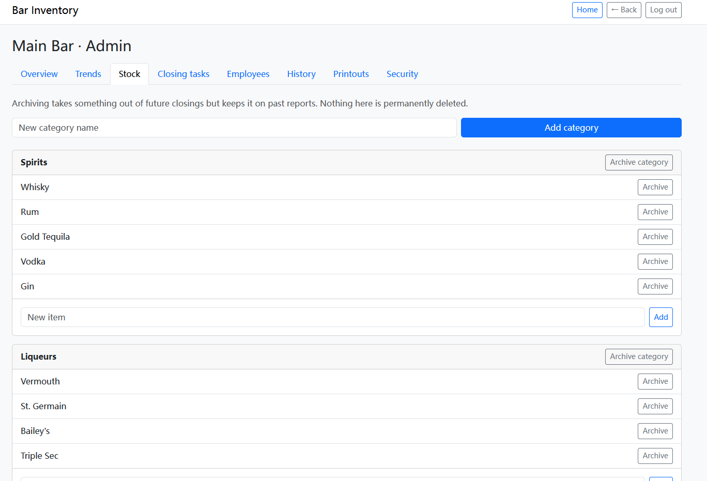
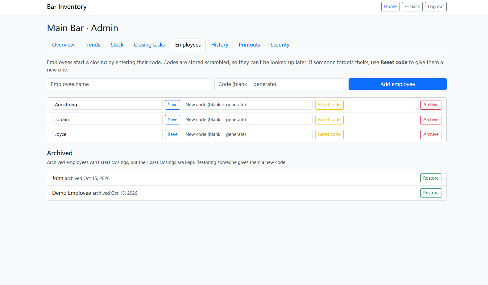
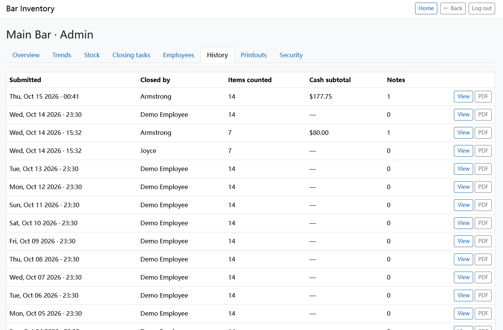
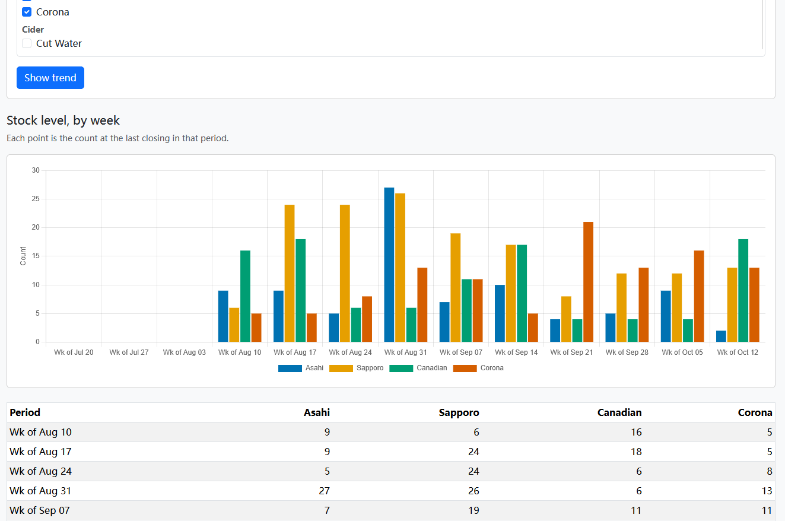

# Close Master

A closing-shift app for bars. Staff would count stock and cash, tick off closing tasks and leave notes. At the end of the night the app will produces a PDF report. Admins would manage stock, staff and tasks, and can look back through past closings and see how stock levels change over time.

## Why I built it

Closing a bar is always a rush: people are tired, the room is dark and loud, and inventory is usually counted on paper or from memory. I work as a bartender, and I wanted to see how much of that routine I could turn into a simple tool: count everything at once, see what changed since the last closing, and hand the manager a clean report.

The problems I kept running into at closing:

- Supplies that were running low got missed, because nothing prompted anyone to check every item.
- Counts lived in a phone notes app, or as a screenshot in a group chat, so there was no proper record of previous inventory.
- Everyone counted in their own way, and often it was only an estimate ("looks low") and not a real number.
- Cash counts were written by hand, and the handwriting was hard to read.
- There was no easy way to leave a note for the manager/the person opening the next day.

Close Master is my attempt to fix these. Every item needs a real number, last closing's count is always on screen, cash is counted by bill and coin, and notes are saved with the closing and printed on a PDF report.

## Screenshots

| | |
|---|---|
|  |  |
| Start a closing with a personal code | Every item needs a count, pre-filled from last time |
|  |  |
| Bill and coin breakdown with a live subtotal | The PDF report staff get after submitting |
|  |  |
| Admin: stock, with archive and restore | Admin: employees and their codes |
|  |  |
| Admin: a past closing in full | Admin: stock level and change over time |

## Features

**Employees (no account needed)**
- Start a closing by entering a personal employee code
- Inventory check: every item must be counted. Boxes start at the previous closing's number (shown grey and italic until touched), with +/- buttons and one **Done** button that saves everything at once
- Cash count with a bill and coin breakdown, a live subtotal and an optional tip pool
- Closing task checklist, and notes for the manager
- A PDF report right after submitting
- Resume an unfinished closing if you leave the page

**Admins (PIN protected)**
- **Overview:** summary of stock, tasks and the latest closing
- **Trends:** pick up to 8 items, group by day, week, month or year over any date range, and chart either the stock level or the change since the previous closing (bars or line), with the exact numbers in a table
- **Stock:** categories and items, with archive and restore
- **Closing tasks:** add, edit, archive and restore
- **Employees:** add, rename, reset or generate codes, archive and restore
- **History:** every submitted closing, with counts compared to the previous closing, cash breakdown, tasks and notes
- **Printouts:** PDF reports by business day
- **Security:** change the admin PIN

## Tech stack

Python 3, Flask (blueprints), Flask-SQLAlchemy with SQLite, Jinja templates, Bootstrap 5, Chart.js, ReportLab for PDFs, plus a little vanilla JavaScript. Bootstrap and Chart.js load from a CDN.

## Getting started

You need Python 3.10 or newer.

```
git clone <this repository's URL>
cd <the folder it creates>

python -m venv venv
venv\Scripts\Activate.ps1        # Windows PowerShell
# source venv/bin/activate       # Mac / Linux

pip install -r requirements.txt
python app.py
```

Open http://localhost:5000.

**First run**
1. Choose **Admin** and enter the temporary PIN `1234`. You are asked to set a new PIN straight away.
2. Open **Employees** and add your staff. Each code is shown **once**: write it down.
3. Open **Stock** and add items to the default categories (Spirits, Liqueurs, Beer, Cider), or add your own categories.
4. Back on the home page, choose **Employee**, then **Start Closing**, and enter an employee code.

**Optional: demo data.** To see the Trends tab filled in without waiting weeks, add a few items and run:

```
python seed_demo_data.py            # adds 60 days of demo closings
python seed_demo_data.py --remove   # deletes them again
```

Demo closings feed the "previous count" shown in new closings, so remove them before real use.

**Configuration.** Two secrets can be set as environment variables. The development defaults work locally, but real deployments must set their own.

```
$env:SECRET_KEY = "a long random string"    # signs session cookies
$env:CODE_PEPPER = "another long random string"   # used when hashing employee codes
```

Changing `CODE_PEPPER` invalidates every employee code. Currency denominations and the "business day" cutoff (a day runs 06:00 to 06:00, so a 1 a.m. closing belongs to the evening before) live in `constants.py`.

## Project structure

```
app.py                  creates the app, seeds first-run data, registers blueprints
models.py               database tables
constants.py            shared settings: currency denominations, business-day cutoff, code rules
security.py             employee code hashing, validation, lookup, wrong-code limiter
printout.py             builds closing report data and renders it as a PDF
trends.py               builds the per-item series for the Trends charts
seed_demo_data.py       adds or removes demo closings
routes/
  employee.py           closing flow: code entry, counts, cash, tasks, notes, PDF
  admin.py              admin login, tab pages, stock/task/employee management
templates/              base layout, employee/ and admin/ pages
static/                 pin-login.js (code and PIN entry), trends.js (charts)
```

## Design decisions

- **Roles through blueprints and decorators.** Employee and admin code live in separate blueprints. `pin_required` protects every admin page and `closing_required` protects every page that only makes sense during an active closing, so a new protected page needs one line.
- **Admin PIN.** Stored hashed (never in plain text), checked for strength, locked for 5 minutes after 5 wrong attempts (stored in the database), and the temporary default PIN must be changed on first login.
- **Employee codes.** Stored as keyed hashes (HMAC-SHA256), so a copy of the database does not reveal anyone's code. Codes are unique, shown once when set, and cannot be looked up later: a forgotten code is replaced, not recovered. Archiving an employee revokes their code immediately. Repeated wrong codes lock a device for 5 minutes.
- **Archive instead of delete.** Items, categories, tasks and employees are archived, never removed, so past reports stay accurate. A closing report is built from what was actually counted in that closing, and finishing a closing records unticked tasks as "not done".
- **One report builder.** The admin detail page and the PDF both use `build_report`, so they cannot disagree.
- **Money.** Denominations are stored as whole cents, totals use `Decimal`, and the browser's live subtotal is for display only: the server recalculates everything on save.
- **Validation on both sides.** The page checks input for a good experience, and the server checks it again, because the page cannot be trusted.
- **Browser history behaviour.** After form submissions the app redirects instead of rendering the result, entry forms submit in the background and replace themselves in history, and pages are sent with `no-store` headers. Pressing Back never reopens a submitted closing or a logged-out admin page.
- **Errors say what went wrong.** Messages name the specific problem, such as which items still need a count or how many attempts are left.

## Limitations and roadmap

Honest list of what this is not yet:

- The data model supports several bars, but the screens assume one.
- SQLite and Flask's development server are fine for a demo, not for production. A real deployment would use a production server and a larger database, and would use Flask-Migrate for schema changes (this project currently resets the dev database when tables change).
- The Trends "change" view cannot tell usage from deliveries, because there is no delivery log. A delivery screen is the natural next feature.
- PDFs use built-in fonts, so non-Latin characters (for example Chinese) will not print.
- The wrong-code limiter is per device and kept in memory, so it resets when the app restarts.
- Bootstrap and Chart.js come from a CDN, so the pages need internet.
- Renaming a closing task changes its wording on old reports. Archive the old one and add a new one if exact old wording matters.
- No automated tests yet. Behaviour was checked by hand against a written checklist.

Ideas I did not get to: showing the previous closing’s notes to the next employee, searching brands and sizes with images, emailing the PDF, photo-based bottle counting, per-bar inventories managed from the admin screens, and CSV export.

## How I built this

I built this while learning Flask, web development and coding in general. I came up with the idea and the shape of the app, and I used an AI assistant (Claude) as a tutor and pair programmer. Claude wrote most of the code, so there is still a lot for me to learn from it, and I would rather say that plainly than pretend otherwise.

I know that AI-written code can turn into a pile of tangled files, so I set rules for how it had to be built. What I did and insisted on:

- **I wrote the original spec:** the closing workflow, the employee and admin sides, the inventory check, cash count, PDF report and the admin summary.
- **I set the rules for the code:** roles that are easy to extend (a new role shouldn't mean rewriting routes), changes that touch only a small part of the app, specific error messages, and everyday buttons like back and refresh, so the code stays clear and easy to change.
- **I tested every step by hand and kept a list of problems and improvements.** For example, I found that pressing Back after a wrong PIN showed "Document Expired" in Firefox, which led to reworking how login and browser history behave.
- **Many features came from using the app:** employee codes instead of picking a name, archiving instead of deleting, notes for the manager, and the tabbed admin dashboard.

Because each step was a small, tested change with its own explanation, the commit history reads like a build log.

## What I learned

Building this taught me more than I expected:

- **How the pieces fit together:** how the front end and back end talk to each other, what the structure of a simple app looks like, and how data is stored in linked tables. I also saw how writing pages as HTML templates differs from building them in a tool like WordPress.
- **Protecting a PIN properly:** hashing it, limiting wrong attempts and forcing a temporary PIN to be changed, following industry practice. I understand the basics so far, but not all of it yet.
- **Good habits:** using Git properly, and writing commit messages that explain each step.
- **Virtual environments:** I started out only knowing them as a folder I activate before working, and learned that they keep each project's packages separate.

**The hardest bug was the browser's Back button.** The browser kept showing pages it had stored earlier, so after an admin logged out, pressing Back could bring the admin page up again, and a wrong PIN followed by Back showed a "Document Expired" error. I only found these by testing by hand, clicking through the app step by step.

**Next time** I would spend much more time planning the structure of the project myself before building, because lining up extra features beforehand is far more efficient than adding them halfway through. I would also explore more tools and approaches before choosing how to build it.

